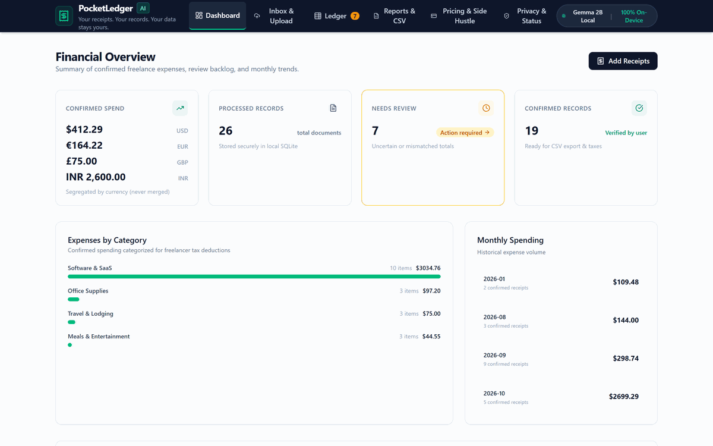
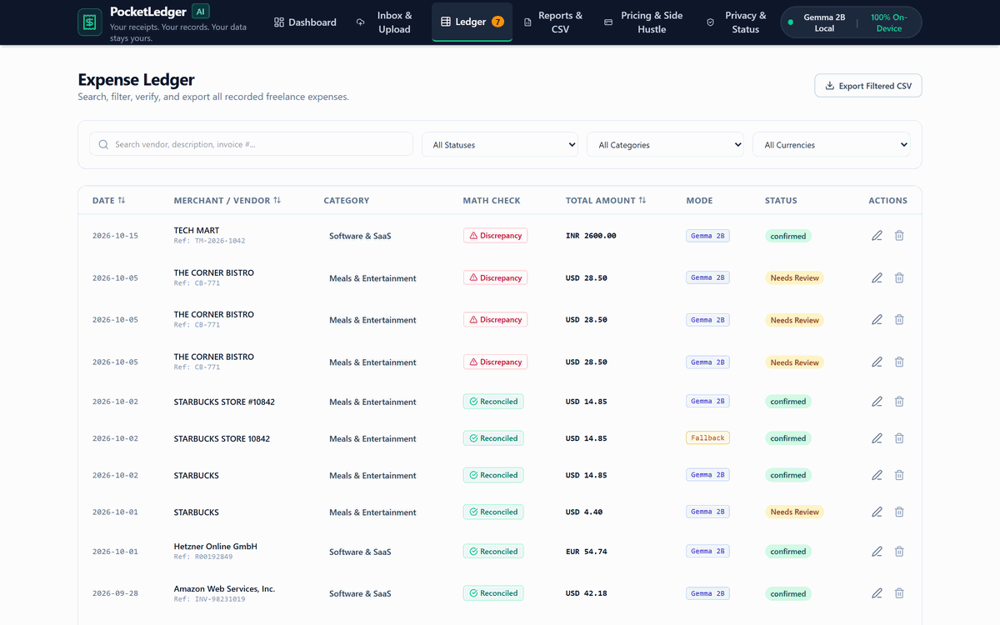
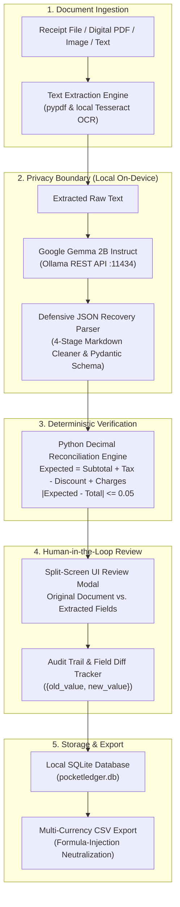

# PocketLedger AI

> **"Your receipts. Your records. Your data stays yours."**  
> A privacy-first, on-device financial assistant for freelancers that transforms messy receipts and invoice PDFs into reviewable, audit-ready expense records using Google's open-weight **Gemma 2B** via Ollama.

[](https://github.com/tribhu05/pocketledger-ai/actions/workflows/ci.yml)
[-brightgreen.svg)](docs/technical-evidence-report.md)
[](LICENSE)
[](https://ai.google.dev/gemma)
[-black.svg)](https://ollama.ai)
[](https://fastapi.tiangolo.com)
[](frontend/)
[](https://pocketledger-ai.onrender.com)

---

### Quick Links & Navigation

* 🌐 **[Live Hosted Application (Render)](https://pocketledger-ai.onrender.com)**
* 🎥 **[50-Second Video Walkthrough (YouTube)](https://youtu.be/Uk_9aB7Z0xo)**
* 📝 **[DEV.to Submission Article](docs/devto-hacktoberfest-week2-final.md)**
* 🔬 **[Technical Evidence & Test Audit](docs/technical-evidence-report.md)**
* 📊 **[Synthetic Benchmark Report](docs/benchmark_report.md)**

---

## 📖 About PocketLedger AI

**PocketLedger AI** is an open-source, privacy-preserving bookkeeping assistant built specifically for freelance developers, independent consultants, and solo creators.

Every quarter, independent professionals face the tedious chore of organizing receipts from cloud hosting (AWS, Vercel, Hetzner), SaaS subscriptions (GitHub, Figma, Notion), coffee meetings, travel, and client expenses. Existing solutions force an unfair choice:
1. **Manual Data Entry:** Spending hours transcribing dates, currencies, and tax totals into spreadsheets.
2. **Cloud AI Scanners:** Uploading sensitive client invoices, home billing addresses, and payment details to third-party proprietary AI APIs.

**PocketLedger AI eliminates this dilemma with a three-layer principle:**

> **AI reads the document. Deterministic code checks the numbers. Humans approve the record.**

1. **Local Open-Weight AI:** Runs Google's **Gemma 2B Instruct** via local Ollama. Document text is extracted and parsed into structured JSON strictly on your machine—zero telemetry, zero cloud network egress.
2. **Deterministic Financial Reconciliation:** Extracted numbers are verified using Python `Decimal` arithmetic. It flags discrepancies (`Subtotal + Tax - Discount + Charges != Total`) rather than hallucinating or silently accepting arithmetic errors.
3. **Human-in-the-Loop Review:** An intuitive split-screen modal allows users to inspect the original receipt side-by-side with extracted fields, make corrections, and explicitly approve records with complete JSON diff tracking.
4. **Multi-Currency Segregation & Defensive CSV:** Expenses in USD, EUR, GBP, and INR remain strictly segregated in tax summaries, and CSV exports apply formula injection sanitization against spreadsheet exploits.

---

## 📸 Product Walkthrough

### 1. Document Extraction & Split-Screen Review
Upload digital PDFs, scanned receipts, or raw text. Gemma extracts merchant, date, amounts, and category; deterministic math verifies reconciliation:



### 2. Multi-Currency Ledger & Injection-Safe CSV Export
Filter by status, search by merchant, and export tax-ready summaries grouped by currency:



---

## 🌟 Key Features

| Capability | What It Does | Why It Matters for Freelancers |
|---|---|---|
| **100% On-Device Privacy** | Local Gemma 2B via Ollama | Client NDA details & addresses never touch the cloud. |
| **Exact Decimal Math** | Python `Decimal` reconciliation engine | Prevents binary floating-point rounding errors (`0.1 + 0.2 != 0.3`). |
| **Discount & Surcharge Logic** | Computes `Subtotal + Tax - Discount + Surcharges` | Prevents missed discounts or miscalculated invoice totals. |
| **Human-in-the-Loop Diffs** | Tracks `user_edits` old vs. new values in JSON | Maintains a defensible, auditable financial paper trail. |
| **Multi-Currency Segregation** | Keeps USD, EUR, GBP, INR separate | Avoids misleading totals that blend un-converted currencies. |
| **Formula Injection Defense** | Sanitizes `=`, `+`, `-`, `@`, `\t` prefixes in CSVs | Shields Excel/Numbers/Sheets users from malicious formula execution. |
| **Transparent Fallback** | Deterministic regex fallback on cloud containers | Hosted evaluators can test the app without downloading 1.6 GB weights. |

---

## 🏗️ Architecture & Data Flow



---

## ⚖️ Local AI vs. Hosted Demo

PocketLedger AI provides two deployment configurations:

| Dimension | Local Mode (Workstation) | Hosted Demo (Render Cloud) |
|---|---|---|
| **Inference Engine** | Local Google Gemma 2B via Ollama | Deterministic Heuristic Fallback |
| **Data Boundary** | 100% On-Device (Zero Network Egress) | Ephemeral Cloud Container |
| **Reconciliation Math** | Python `Decimal` Engine | Python `Decimal` Engine |
| **Review & Audit** | Full split-screen with diff tracking | Full split-screen with diff tracking |
| **Persistence** | Persistent SQLite (`pocketledger.db`) | In-memory SQLite database |
| **System Status Pill** | `gemma2_local` (Green) | `deterministic_fallback` (Amber) |
| **Live Endpoint** | `http://localhost:8000/api/status` | `https://pocketledger-ai.onrender.com/api/status` |

---

## 🚀 Quickstart Guide

### Option A: Local Full-Stack Setup (Recommended for Full Gemma Experience)

#### Prerequisites
- **Python:** 3.10+ (tested through 3.14)
- **Node.js:** 18+ and npm
- **Ollama:** [Install Ollama](https://ollama.ai)

#### 1. Start Ollama and Pull Gemma 2B
```bash
# 1. Start Ollama daemon
ollama serve

# 2. Pull the Gemma 2B Instruct model (1.6 GB)
ollama pull gemma2:2b
```

#### 2. Set Up and Run the Backend
```bash
# Clone the repository
git clone https://github.com/tribhu05/pocketledger-ai.git
cd pocketledger-ai

# Create virtual environment
python -m venv .venv

# Activate virtual environment
# Windows:
.venv\Scripts\activate
# macOS/Linux:
source .venv/bin/activate

# Install dependencies
pip install -r requirements.txt

# Start FastAPI backend
uvicorn backend.main:app --port 8000 --reload
```

#### 3. Set Up and Run the Frontend
In a second terminal:
```bash
cd frontend
npm install
npm run dev
```
Open **[http://localhost:5173](http://localhost:5173)** in your browser.

---

### Option B: Docker Container Deployment

You can run the entire unified application (React build + FastAPI + Tesseract) in a single container:

```bash
# Build the Docker image
docker build -t pocketledger-ai .

# Run container on port 10000
docker run -p 10000:10000 -e PORT=10000 pocketledger-ai
```
Open **[http://localhost:10000](http://localhost:10000)** in your browser.

---

### Option C: Deploy to Render via Blueprint

The repository contains a declarative [`render.yaml`](render.yaml) blueprint:
1. Fork or push this repository to GitHub.
2. In the [Render Dashboard](https://dashboard.render.com), click **New +** -> **Blueprint**.
3. Select your repository. Render automatically configures the Docker runtime, sets health checks on `/api/status`, and provisions the service.

[](https://render.com/deploy?repo=https://github.com/tribhu05/pocketledger-ai)

---

## 🧪 Automated Test Suite & Quality Verification

PocketLedger AI features **100% automated test pass rate** across backend unit/integration tests and frontend Vitest component tests:

```text
$ pytest backend/tests/test_backend.py -v
============================= test session starts =============================
platform win32 -- Python 3.14.0, pytest-9.1.1, pluggy-1.6.0
collected 16 items

backend/tests/test_backend.py::test_reconciliation_math PASSED           [  6%]
backend/tests/test_backend.py::test_record_validation_backward_compatibility PASSED [ 12%]
backend/tests/test_backend.py::test_date_normalization PASSED            [ 18%]
backend/tests/test_backend.py::test_currency_normalization PASSED        [ 25%]
backend/tests/test_backend.py::test_csv_injection_sanitization PASSED    [ 31%]
backend/tests/test_backend.py::test_csv_export_multi_currency_segregation PASSED [ 37%]
backend/tests/test_backend.py::test_deterministic_fallback PASSED        [ 43%]
backend/tests/test_backend.py::test_api_status_endpoint PASSED           [ 50%]
backend/tests/test_backend.py::test_raw_text_upload_and_review_workflow PASSED [ 56%]
backend/tests/test_backend.py::test_discount_reconciliation_workflow PASSED [ 62%]
backend/tests/test_backend.py::test_exact_decimal_arithmetic_drift_prevention PASSED [ 68%]
backend/tests/test_backend.py::test_currency_anomaly_detection PASSED    [ 75%]
backend/tests/test_backend.py::test_schema_currency_string_coercion PASSED [ 81%]
backend/tests/test_backend.py::test_gemma_json_parser_robustness PASSED  [ 87%]
backend/tests/test_backend.py::test_synthetic_scenarios_reconciliation PASSED [ 93%]
backend/tests/test_backend.py::test_formula_injection_defense_suite PASSED [100%]

============================= 16 passed in 10.34s =============================

$ cd frontend && npm test -- --run
✓ src/test/App.test.tsx (7 tests) 1189ms
Test Files  1 passed (1)
     Tests  7 passed (7)
```

| Test Suite | Total Tests | Pass Rate | Key Aspects Verified |
|---|:---:|:---:|---|
| **Backend (Pytest)** | 16 | **100%** | Decimal reconciliation math, discount & surcharge logic, formula injection sanitization, multi-currency export segregation, JSON parsing recovery, date normalization. |
| **Frontend (Vitest)** | 7 | **100%** | Status pills, dashboard KPI metrics, ledger search & filtering, split-screen review modal, CSV download triggers. |
| **Total** | **23** | **100%** | Comprehensive full-stack test coverage. |

*Detailed test report: see [`docs/technical-evidence-report.md`](docs/technical-evidence-report.md).*

---

## 📊 Benchmark Evaluation

Tested across diverse synthetic freelancer expense scenarios (AWS hosting, Figma subscriptions, train tickets, cafe meetings, smudged receipts, and Indian GST invoices):

| Evaluation Dimension | Local Gemma 2B (Ollama) | Deterministic Fallback | Notes |
|---|:---:|:---:|---|
| **Hardware** | AMD Ryzen 3 7320U (8 GB RAM) | Python in-memory | Open-weight local LLM vs. regex parser |
| **Merchant Name** | **8 / 8 correct** (100%) | **10 / 10 correct** (100%) | Accurately isolates merchant name |
| **Total Amount** | **8 / 8 correct** (100%) | **10 / 10 correct** (100%) | Preserves `null` when receipt total is unreadable |
| **Currency** | **8 / 8 correct** (100%) | **10 / 10 correct** (100%) | Converts $, €, £, ₹ to standard ISO codes |
| **Document Type** | **8 / 8 correct** (100%) | **10 / 10 correct** (100%) | Distinguishes invoices from receipts |
| **Transaction Date** | **7 / 8 correct** (87.5%) | **9 / 10 correct** (90%) | Normalized to ISO-8601 (YYYY-MM-DD) |
| **Average Latency** | **34.1 s** | **0.58 ms** | Local on-device CPU execution |

*Complete benchmark methodology: see [`docs/benchmark_report.md`](docs/benchmark_report.md).*

---

## 📁 Repository Structure

```text
pocketledger-ai/
├── .github/
│   ├── workflows/ci.yml           # Automated CI running Pytest & Vitest
│   ├── ISSUE_TEMPLATE/            # Bug report and feature request templates
│   └── pull_request_template.md   # Standardized PR checklist
├── backend/
│   ├── config.py                  # Pydantic environment configuration
│   ├── database.py                # SQLite database session and models
│   ├── demo_data.py               # 10 realistic synthetic test scenarios
│   ├── export.py                  # Defensive CSV export & injection sanitizer
│   ├── fallback_extractor.py      # Deterministic heuristic fallback parser
│   ├── gemma_extractor.py         # Ollama Gemma 2B client & 4-stage JSON parser
│   ├── main.py                    # FastAPI endpoints & static file server
│   ├── ocr.py                     # pypdf extraction & local Tesseract OCR
│   ├── schemas.py                 # Pydantic schemas & strict type coercion
│   ├── validator.py               # Python Decimal financial reconciliation math
│   └── tests/test_backend.py      # 16 automated backend unit and integration tests
├── frontend/
│   ├── src/
│   │   ├── components/            # ReviewModal, StatusPill, LedgerTable, etc.
│   │   ├── test/App.test.tsx      # 7 automated Vitest frontend tests
│   │   ├── types.ts               # Synchronized TypeScript interfaces
│   │   └── App.tsx                # Main single-page application
│   ├── package.json               # React 19 + TypeScript + Vite + Tailwind CSS
│   └── vite.config.ts             # Vite build configuration & test setup
├── docs/
│   ├── screenshots/               # Verified UI screenshots and product GIFs
│   ├── benchmark_report.md        # Detailed synthetic benchmark report
│   ├── technical-evidence-report.md # Comprehensive engineering evidence audit
│   └── devto-hacktoberfest-week2-final.md # Complete DEV.to challenge submission
├── Dockerfile                     # Multi-stage production container build
├── render.yaml                    # Infrastructure-as-Code Blueprint for Render
├── requirements.txt               # Locked Python dependencies
├── CONTRIBUTING.md                # Contribution guidelines and setup instructions
├── CODE_OF_CONDUCT.md            # Contributor Code of Conduct
├── SECURITY.md                    # Threat model and vulnerability reporting
└── LICENSE                        # MIT Open Source License
```

---

## 🤝 Contributing

We welcome contributions from the community!
1. Check existing issues or open a new one in [GitHub Issues](https://github.com/tribhu05/pocketledger-ai/issues).
2. Read [`CONTRIBUTING.md`](CONTRIBUTING.md) for code conventions and testing protocols.
3. Review [`SECURITY.md`](SECURITY.md) for our privacy boundary and threat model.
4. Verify all tests pass before submitting a PR:
   ```bash
   python -m pytest backend/tests/test_backend.py -v
   cd frontend && npm run lint && npx vitest run && npm run build
   ```

---

## 📜 License

* **Application Code:** Licensed under the **[MIT License](LICENSE)**.
* **Gemma Model:** Usage of Google's Gemma model weights is subject to the **[Gemma Terms of Use](https://ai.google.dev/gemma/terms)** and Google Responsible AI policies.
