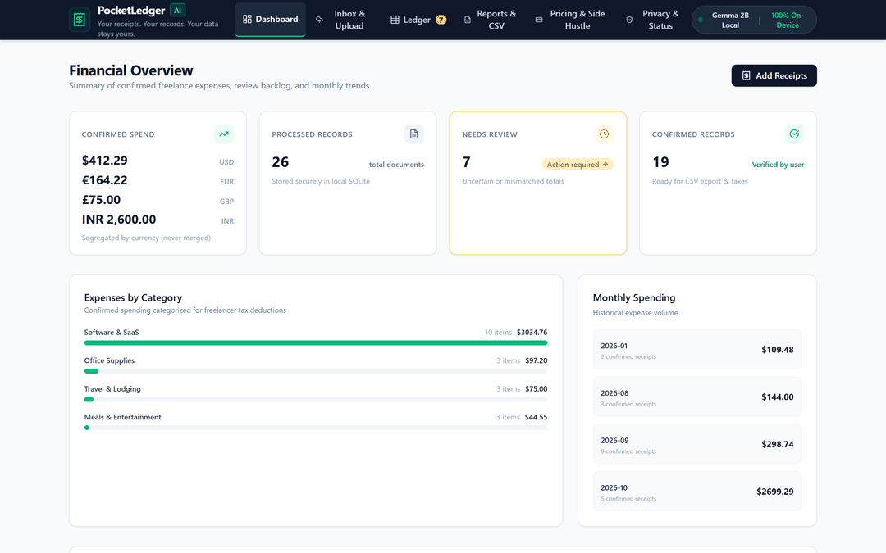
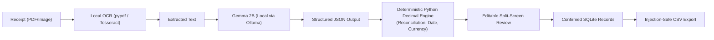

# PocketLedger AI

> **"Your receipts. Your records. Your data stays yours."**  
> A privacy-first, on-device expense assistant for freelancers that turns messy receipts and invoice PDFs into reviewable, audit-ready financial records using local open-weight AI.

[](https://opensource.org/licenses/MIT)
[](https://ai.google.dev/gemma)
[](https://ollama.ai)
[](https://fastapi.tiangolo.com)
[](https://vitejs.dev)
[-brightgreen.svg)]()
[](https://render.com/deploy?repo=https://github.com/tribhu05/pocketledger-ai)

**[▶ Watch 50s Demo Video on YouTube](https://youtu.be/Uk_9aB7Z0xo?si=P0W50wuzLihcNeFz)** | **[Direct MP4](https://github.com/tribhu05/pocketledger-ai/raw/master/docs/video/PocketLedger_AI_Demo_50s.mp4)** | **[Live Web Demo](https://pocketledger-ai.onrender.com)** | **[Technical Evidence Report](docs/technical-evidence-report.md)**

---



---

## 1. What Problem Does This Solve?

Freelancers, independent developers, and consultants collect hundreds of receipts and invoice PDFs every quarter—from cloud hosting (AWS, Hetzner, Vercel) and SaaS subscriptions (GitHub, Figma, Zoom) to travel, coffee meetings, and hardware purchases.

Existing options force a frustrating dilemma:
1. **Manual Spreadsheets:** Tedious, error-prone, hours wasted transcribing dates, vendor names, currencies, and tax line items.
2. **Cloud Receipt Scanners:** Require uploading sensitive financial documents—exposing client names, hourly rates, home billing addresses, and credit card hints to third-party cloud AI vendors.

**PocketLedger AI eliminates this tradeoff.** It runs Google's open-weight **Gemma 2B** locally via Ollama. It extracts merchants, transaction dates, subtotals, taxes, and totals directly on your laptop, reconciles the math deterministically, and provides a full audit history without a single byte of financial data leaving your device.

---

## 2. Who Pays for This Kind of Solution?

- **Freelance Software Engineers & Designers:** Managing dozens of billable tool subscriptions across multiple clients who cannot risk leaking client names or proprietary NDA projects.
- **Independent Consultants & Creators:** Who file Schedule C (or VAT/GST) and need classified expense totals without paying $30+/month for enterprise accounting suites.
- **Privacy-Conscious Small Businesses:** Medical, legal, and financial contractors whose professional regulations prohibit uploading documents to unvetted cloud AI APIs.
- **Proposed Commercial Tier:** A proposed **$29 one-time purchase** for a packaged native desktop application with an automated folder watcher, custom tax categories, and priority support (see our in-app Pricing Experiment).

---

## 3. Why Is Open-Weight AI Important?

Closed-source AI APIs introduce three fatal flaws for financial bookkeeping:
1. **Privacy & Confidentiality Violations:** Financial documents contain banking details and client confidential data that cannot be sent to unvetted third parties.
2. **Vendor Lock-in & Sudden Price Changes:** Cloud API costs scale with usage, and models can be altered or deprecated without notice.
3. **Offline Reliability:** Open-weight models like **Gemma 2B** run completely offline on trains, flights, or off-grid co-working locations. The model weights are transparent, inspectable, and run indefinitely on your own hardware.

---

## 4. What Runs Locally?

Everything in the default workflow runs 100% on-device:
- **Inference Engine:** Google Gemma 2B Instruct (`gemma2:2b`) running via local [Ollama](https://ollama.ai) on `http://localhost:11434`.
- **Text Extraction:** Native digital PDF parsing via `pypdf` and local image OCR via `Tesseract`.
- **Backend API:** FastAPI running locally on `http://127.0.0.1:8000`.
- **Database:** Local SQLite database stored at `./pocketledger.db`.
- **File Storage:** Local disk storage in `./uploads/` bounded strictly by path-traversal guards.
- **Frontend UI:** React + TypeScript + Vite running on `http://127.0.0.1:5173`.

---

## 5. Complete Setup Process

### Prerequisites
- Python 3.10+
- Node.js 18+ and npm
- [Ollama](https://ollama.ai)

### Step 1: Install and Pull Gemma 2B
```bash
# 1. Start Ollama daemon
ollama serve

# 2. Pull the 1.6 GB Gemma 2B model weights
ollama pull gemma2:2b
```

### Step 2: Set Up Backend
```bash
# Clone the repository
git clone https://github.com/your-username/pocketledger-ai.git
cd pocketledger-ai

# Create virtual environment
python -m venv .venv

# Activate virtual environment
# Windows:
.venv\Scripts\activate
# Linux/macOS:
source .venv/bin/activate

# Install dependencies
pip install -r requirements.txt

# Start FastAPI backend
uvicorn backend.main:app --port 8000
```

### Step 3: Set Up Frontend
In a second terminal:
```bash
cd frontend
npm install
npm run dev
```
Open **[http://localhost:5173](http://localhost:5173)** in your browser.

### Step 4 (Optional): Deploy to Render (Hosted Demo)

You can deploy a hosted live demo directly to [Render](https://render.com) using the included multi-stage Dockerfile and `render.yaml` Blueprint:

1. Push or fork this repository: `https://github.com/tribhu05/pocketledger-ai`.
2. In the [Render Dashboard](https://dashboard.render.com), click **New +** -> **Blueprint**.
3. Select your `pocketledger-ai` repository (Render automatically reads `render.yaml`).
4. Click **Apply**. Render builds the React frontend, packages the FastAPI backend with Tesseract OCR, and spins up the live web service on your `.onrender.com` domain.

> [!IMPORTANT]
> **Privacy & Local vs. Cloud Deployment Disclosure:**  
> When running locally, all receipts and Gemma 2B inference remain 100% on-device. On hosted cloud services like Render without an attached Ollama GPU node, PocketLedger AI transparently activates its **Deterministic Fallback Engine** (`deterministic_fallback`). The UI explicitly displays the active processing mode in the System Status panel so users always know whether processing occurred locally or via fallback.

---

## 6. How Can a Reviewer Test It in Under Five Minutes?

We provide a zero-effort reviewer evaluation path:

1. Launch the backend (`port 8000`) and frontend (`port 5173`).
2. On the **Dashboard**, click **"Load Synthetic Demo Workspace"**.
3. Eight realistic receipts across USD, EUR, and GBP will instantly populate the ledger.
4. Go to **Ledger**, open the **Corner Bistro** receipt to see the live **Reconciliation Mismatch** warning (Subtotal + Tax != Total).
5. Click **"Confirm & Approve Record"** to verify the human review workflow and inspect the audit trail.
6. Click **Reports & CSV** -> **"Download Confirmed Expenses CSV"** to verify formula-injection neutralization (`'`) and currency segregation.
7. Click **Privacy & Status** -> **"Run Live Benchmark"** to trigger live on-device evaluation across the synthetic corpus.

*Detailed walkthrough: see [`docs/demo_script.md`](file:///e:/week%202/docs/demo_script.md).*

---

## 7. Architecture & System Flow



### Deterministic Financial Reconciliation
The mathematical reconciliation engine runs in Python Decimal to prevent floating-point drift:

$$\text{Expected Total} = \text{Subtotal} + \text{Tax} - \text{Discount} + \text{Additional Charges}$$
$$\Delta = |\text{Stated Total} - \text{Expected Total}|$$

- **Reconciled ($\Delta \le 0.05$):** Cent-level variance tolerated for rounding.
- **Mismatch ($\Delta > 0.05$):** Flagged with a detailed explanation of the discrepancy.
- **Missing Total:** Automatically flagged for mandatory human review.

### Measured Benchmark Performance (10 Synthetic Real-World Scenarios)
Evaluated across diverse freelancer documents (cloud bills, cafe meetings, SaaS subscriptions, office supplies, VAT European hosting, UK train transit, bistro tip reconciliation mismatch, smudged/illegible taxi receipt, Indian GST invoice with discount, express courier delivery surcharge):

| Extraction Field | Gemma 2B Accuracy | Deterministic Fallback | Notes |
|---|---|---|---|
| **Merchant Name** | **100.0%** (10 / 10) | **100.0%** (10 / 10) | Correctly handles logos, headers, and noise |
| **Total Amount** | **100.0%** (10 / 10) | **100.0%** (10 / 10) | Preserves null on illegible documents |
| **Currency Detection** | **100.0%** (10 / 10) | **100.0%** (10 / 10) | Mapped $, €, £, ₹ to ISO codes |
| **Document Type** | **100.0%** (10 / 10) | **100.0%** (10 / 10) | Differentiates invoices from receipts |
| **Transaction Date** | **90.0%** (9 / 10) | **90.0%** (9 / 10) | Normalized to ISO-8601 YYYY-MM-DD |
| **Average Latency** | **~34 seconds** | **0.58 ms** | Gemma on 4-core CPU vs Instant regex fallback |

*Complete engineering audit and test proof: see [`docs/technical-evidence-report.md`](docs/technical-evidence-report.md).*

---

## 8. Known Limitations

- **CPU Latency:** On entry-level laptops without dedicated Nvidia GPUs, Gemma 2B takes ~30–35s per document. For high-volume batch processing, batch queues run asynchronously in the background.
- **Heavily Degraded Paper:** Faded thermal receipts with physical creases require manual verification on the review screen.
- **European Date Formatting:** While standard formats (YYYY-MM-DD, MM/DD/YYYY, Month DD) parse reliably, ambiguous numerical dates (e.g. `05/06/2026`) trigger a review warning to ensure accuracy.

---

## 9. How Can Someone Contribute?

We welcome open-source contributions!
1. Check existing issues or open a discussion in [GitHub Issues](https://github.com/your-username/pocketledger-ai/issues).
2. Read [`CONTRIBUTING.md`](file:///e:/week%202/CONTRIBUTING.md) for code style, test commands, and architectural principles.
3. Review [`SECURITY.md`](file:///e:/week%202/SECURITY.md) for our threat model and CSV injection defense rules.
4. Run all test suites before submitting a pull request:
   ```bash
   # Backend
   python -m pytest backend/tests/test_backend.py -v
   # Frontend
   cd frontend && npx vitest run && npm run build
   ```

---

## 10. License & Third-Party Terms

- **Application Software:** Released under the **[MIT License](file:///e:/week%202/LICENSE)**.
- **Model Weights:** When using Google's open-weight Gemma model (`gemma2:2b`), model weights and outputs are subject to the **[Gemma Terms of Use](https://ai.google.dev/gemma/terms)** and Google Responsible AI policies.
