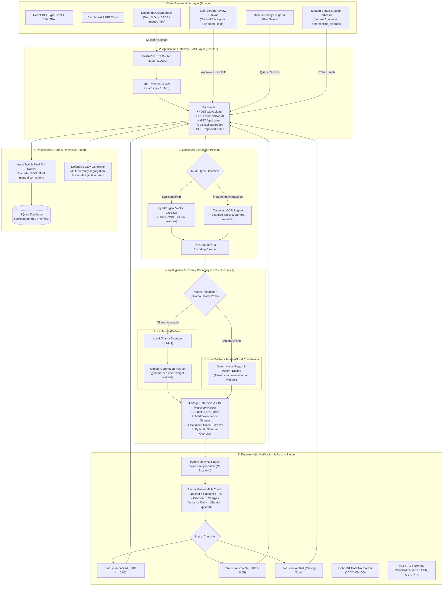
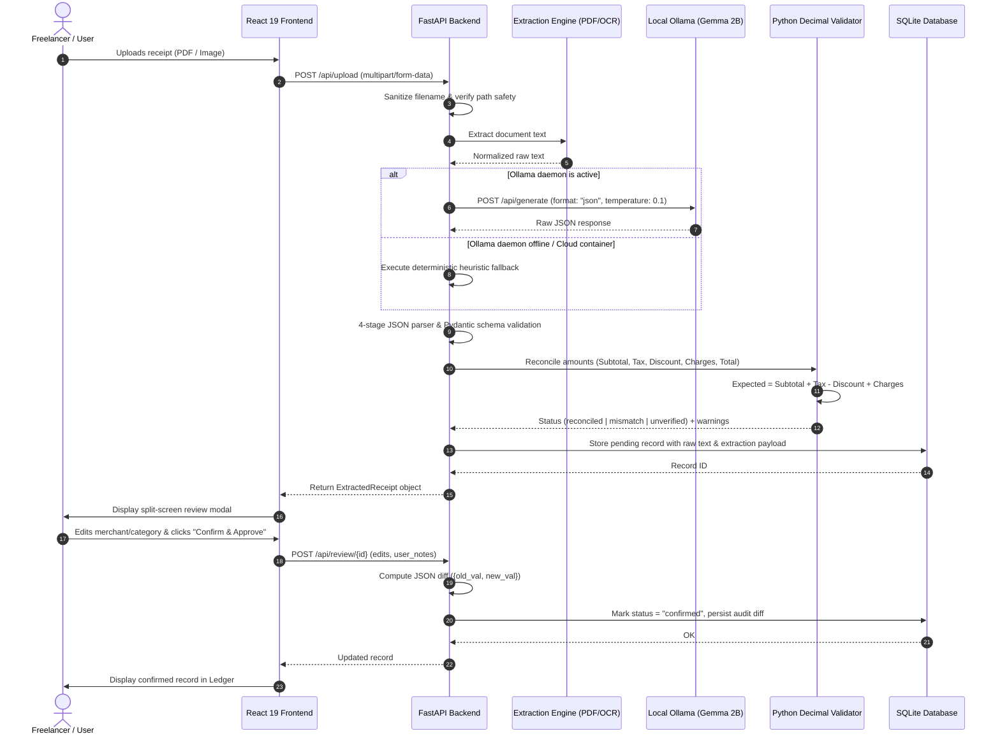
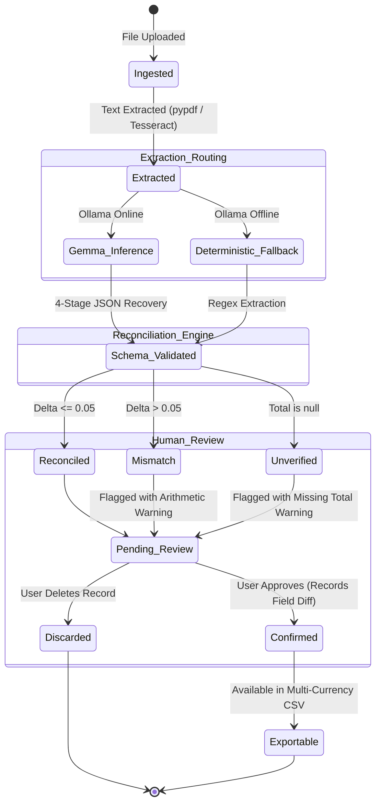

# PocketLedger AI — System Architecture & Technical Specification

> **"AI reads the document. Deterministic code checks the numbers. Humans approve the record."**

PocketLedger AI is engineered on a **local-first, privacy-by-design architecture**. It is specifically designed for freelancers, independent developers, and consultants who require automated receipt extraction without exposing sensitive financial invoices to third-party cloud AI vendors.

---

## 1. System Topology & Architectural Layers

The architecture is divided into five strictly decoupled layers with an enforced **On-Device Privacy Boundary**:



---

## 2. End-to-End Processing Sequence

The sequence diagram illustrates how a receipt flows from raw upload to verified storage:



---

## 3. Financial Document State Machine

Every document ingested by PocketLedger AI transitions through strict lifecycle states:



---

## 4. Key Architectural Safeguards

### 4.1. IEEE 754 Floating-Point Drift Elimination
Binary floating-point types (`float` in Python/JavaScript) cannot precisely represent decimal currency fractions:
```python
# The standard float hazard:
0.1 + 0.2 == 0.30000000000000004  # False!
```
In PocketLedger AI, all calculations in [`backend/validator.py`](../backend/validator.py) use Python's built-in `Decimal` with fixed 2-place quantizing:

$$\text{Expected Total} = \text{Subtotal} + \text{Tax} - \text{Discount} + \text{Additional Charges}$$
$$\Delta = |\text{Stated Total} - \text{Expected Total}|$$

A configured tolerance of `0.05` accounts for minor cent-rounding variances across regional tax laws without masking legitimate discrepancies.

### 4.2. 4-Stage Defensive JSON Recovery
Small open-weight LLMs (such as 2B parameter models) occasionally output conversational preamble or markdown code fences even when requested to output strict JSON. Rather than crashing, [`backend/gemma_extractor.py`](../backend/gemma_extractor.py) executes a 4-tier recovery cascade:
1. **Direct Parse:** Attempts `json.loads(raw_text)`.
2. **Markdown Fence Stripping:** Regex isolates ````json { ... } ```` blocks.
3. **Outer Balanced Braces:** Finds first `{` and last `}` to isolate valid JSON objects.
4. **Pydantic Type Coercion:** Strips currency symbols (`$1,234.50` → `1234.50`) and treats `NaN`/unreadable values as `None`.

### 4.3. Anti-CSV Injection Defense
Spreadsheet software (Microsoft Excel, LibreOffice Calc, Apple Numbers, Google Sheets) interprets cells starting with formula trigger symbols as executable expressions. Malicious receipt text containing `=cmd|' /C calc'!A0` or `-2+3+cmd|...` poses a serious risk to freelancers opening downloaded CSVs.

PocketLedger AI implements formula neutralization in [`backend/export.py`](../backend/export.py):
```python
def sanitize_csv_cell(val: Any) -> Any:
    if val is None:
        return ""
    val_str = str(val).strip()
    if val_str.startswith(("=", "+", "-", "@", "\t", "\r")):
        return f"'{val_str}"
    return val_str
```
Every potentially malicious cell is prefixed with a single quote (`'`), forcing spreadsheet software to treat the contents strictly as plaintext.

### 4.4. Multi-Currency Segregation
Adding `100 USD + 100 EUR + 100 GBP` without exchange rate conversion results in corrupt tax reporting. PocketLedger's reporting engine automatically partitions summary data by currency code:
```text
Tax Summary by Currency:
  • USD: $1,420.50 (Tax: $122.10)
  • EUR: €340.00   (VAT: €64.60)
  • GBP: £85.20    (VAT: £14.20)
  • INR: ₹2,600.00 (GST: ₹414.00)
```

---

## 5. Technology Stack Summary

| Layer | Technology | Version | Purpose |
|---|---|---|---|
| **Frontend Framework** | React | 19.x | Component-driven UI and responsive review modal |
| **Frontend Language** | TypeScript | 5.x | Strict type safety synchronized with backend schemas |
| **Bundler & Build** | Vite | 5.x | Instant HMR development and optimized production bundles |
| **Styling & Icons** | Tailwind CSS & Lucide | 3.x / Latest | High-contrast dark/light accessible financial interface |
| **Backend Framework** | FastAPI | 0.115+ | High-performance asynchronous REST API |
| **Python Runtime** | Python | 3.11 / 3.14 | Modern async/await and native `Decimal` engine |
| **AI Model** | Google Gemma 2B Instruct | `gemma2:2b` | Open-weight on-device entity extraction |
| **Local Inference Host** | Ollama | 0.3+ | Local model serving with low-temperature JSON formatting |
| **Text Extraction** | `pypdf` & `pytesseract` | Latest | Dual digital-PDF and OCR raster image processing |
| **Database** | SQLite | 3.x | Persistent local storage (`pocketledger.db`) |
| **Containerization** | Docker | Multi-stage | Single-container deployment (Vite dist + FastAPI + Tesseract) |
| **Cloud Hosting** | Render | Blueprint | Continuous deployment via `render.yaml` with health probes |
