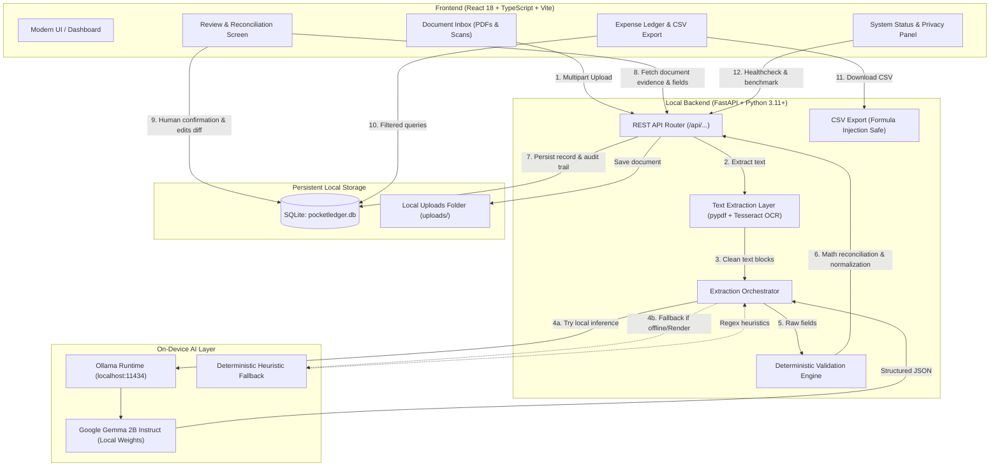

*This is a submission for the [Hacktoberfest Open-Source AI Challenge Week 2: Side Hustle](https://dev.to/challenges/hacktoberfest-week2-2026-10-12)*

---


## 1. The Freelance Panic at 11:45 PM

Every three months, the familiar freelance dread settles in.

It usually starts with a curt email subject line from my accountant: *"Q3 Estimated Taxes Due in 48 Hours."* I crack open my laptop, open an unruly desktop folder named `receipts_to_sort_eventually`, and brace myself for an entire evening of manual data entry. AWS server invoices, GitHub copilot licenses, a coffee receipt from an emergency client scoping session, train tickets to a co-working space, a replacement monitor cable from Best Buy.

Like most developers in 2026, my immediate reaction was to find an AI receipt scanner to automate the pain away. But as I evaluated commercial bookkeeping tools, I stopped dead at their mandatory terms:

> *"By proceeding, you grant permission to upload all invoices, banking statements, and receipts to our cloud servers and third-party inference sub-processors."*

Wait a minute. Those PDFs contain client corporate names under strict non-disclosure agreements, hourly billing breakdowns, my legal home address, and partial payment card numbers. Why should sorting freelance business deductions require handing confidential financial records over to a third-party AI company’s cloud?

For the Hacktoberfest Open-Source AI "Side Hustle" challenge, I built the co-pilot I actually wanted to use: **PocketLedger AI**.

PocketLedger AI is an expense-management co-pilot designed for freelancers. It pairs local open-weight AI (**Google’s Gemma 2B via Ollama**) with strict deterministic financial math, human-in-the-loop review, and local SQLite persistence.

The design philosophy is straightforward:  
**AI reads the document. Deterministic code checks the numbers. Humans approve the record.**

---

## 2. Demo

Watch the complete 50-second video demo showing real on-device extraction, validation, and export:



▶️ **[Watch the Demo on YouTube](https://youtu.be/Uk_9aB7Z0xo?si=P0W50wuzLihcNeFz)**  
*(Video specs: Exactly 50.00 seconds, 1920×1080 @ 30 fps, studio voiceover with AndrewNeural, burned-in subtitles, and genuine application footage).*

- **Live Hosted Walkthrough:** [https://pocketledger-ai.onrender.com](https://pocketledger-ai.onrender.com) *(Hosted on Render with zero-setup deterministic fallback parser)*
- **Direct Video File:** [PocketLedger_AI_Demo_50s.mp4 (Raw MP4)](https://github.com/tribhu05/pocketledger-ai/raw/master/docs/video/PocketLedger_AI_Demo_50s.mp4)

### Interactive Workflow at a Glance


The application moves financial records through five distinct states:
1. **Inbox Drop:** Ingest digital PDF invoices or photo receipt scans.
2. **Dual Extraction:** Digital text is extracted cleanly with `pypdf`, while physical photo scans pass through local `tesseract` OCR.
3. **Structured Semantic Extraction:** Gemma 2B processes the raw text with a locked temperature (`0.1`) and returns a typed JSON schema.
4. **Deterministic Math Reconciliation:** Independent Python code tests `subtotal + tax - discount + charges = total`.
5. **Human Review & Audit:** Every field is editable with diff tracking before entering the permanent SQLite ledger.

---

## 3. Code

The entire codebase is open-source under the permissive MIT license:



- **GitHub Repository:** [https://github.com/tribhu05/pocketledger-ai](https://github.com/tribhu05/pocketledger-ai)
- **License:** MIT License
- **Stack:** Python 3.11+ (FastAPI, Pydantic v2, aiosqlite, pypdf, pytesseract), React 18, TypeScript, Vite, Tailwind CSS, Lucide icons, Ollama (`gemma2:2b`).

---

## 4. What I Built: An Expense Co-Pilot with Privacy by Design

Freelancers do not need an enterprise-grade ERP system like SAP or a bloated $40/month QuickBooks subscription just to track SaaS subscriptions, equipment write-offs, and client travel expenses.

Existing solutions force independent developers into a bad compromise:
1. **The Spreadsheet Drag:** Manually opening every PDF, copying dates, subtotals, and taxes into Excel. It is error-prone, takes hours every quarter, and results in missed deductions.
2. **The Cloud AI Sump:** Forwarding every receipt to a cloud SaaS. The user forfeits control over where invoices are stored, whether models are trained on their client contracts, and who has access to sub-processor databases.

PocketLedger AI provides a third path: **local-first automation with deterministic guarantees**.


### Key Capabilities Built:
- **Document Inbox & Digital PDF Parser:** Ingests `.pdf`, `.png`, `.jpg`, `.jpeg`, and `.webp` documents up to 15 MB. Invoices from AWS, Stripe, GitHub, Hetzner, or Vercel are parsed digitally through `pypdf`, preserving exact numbers without OCR pixel distortion.
- **Physical Receipt OCR:** Camera photo receipts undergo automatic grayscale conversion and contrast enhancement before passing to local Tesseract OCR.
- **On-Device Gemma 2B Semantic Extraction:** Runs Google's open-weight `gemma2:2b` through a local Ollama daemon to extract vendor, invoice number, transaction date, line-item totals, tax, discount, currency, and freelance tax category.
- **Deterministic Math Reconciliation:** Automatically checks arithmetic integrity (`subtotal + tax - discount + additional_charges = total`) within a configurable 0.05 rounding tolerance. Discrepancies are visually highlighted before records reach the ledger.
- **Interactive Split-Screen Review:** Allows side-by-side verification of original receipts against extracted fields, saving a full JSON diff in `user_edits`.
- **Searchable Multi-Currency Ledger:** Filters by merchant, tax category, date range, currency, and reconciliation status.
- **CSV Tax Export with Formula Injection Defense:** Neutralizes spreadsheet execution exploits and segregates multi-currency totals.
- **System Status & Privacy Inspector:** Provides real-time visibility into Ollama connectivity, model availability, OCR engine health, and database integrity.

---

## 5. How I Built It: System Architecture & Implementation

### 5.1 Architecture Overview

PocketLedger AI separates concerns into four distinct layers:



---

### 5.2 Dual-Path Document Ingestion

Not all expense documents are created equal. A digital invoice generated by AWS or Stripe has crisp, embedded font glyphs, while a crumpled restaurant receipt taken with a phone camera is a noisy image.

In `backend/ocr.py`, we implement a dual-engine ingestion pipeline:

```python
async def extract_text_from_document(file_path: str, mime_type: str) -> Tuple[str, str]:
    """
    Dual-engine document text extractor:
    - Digital PDF: Native text extraction via pypdf (100% precision, no raster noise)
    - Image/Scan: Local Tesseract OCR with adaptive contrast preprocessing
    """
    if mime_type == "application/pdf":
        try:
            reader = pypdf.PdfReader(file_path)
            extracted_text = ""
            for page in reader.pages:
                text = page.extract_text()
                if text:
                    extracted_text += text + "\n"
            if len(extracted_text.strip()) > 20:
                return extracted_text.strip(), "pypdf_digital"
        except Exception as e:
            logger.warning(f"pypdf digital extraction failed: {e}. Falling back to OCR.")

    # Image preprocessing for camera scans
    image = Image.open(file_path)
    if image.mode != "L":
        image = image.convert("L")  # Convert to grayscale
    # Contrast enhancement for faded thermal receipts
    enhancer = ImageEnhance.Contrast(image)
    image = enhancer.enhance(1.8)

    ocr_text = pytesseract.image_to_string(image)
    return ocr_text.strip(), "tesseract_ocr"
```

By extracting digital text directly with `pypdf`, we bypass OCR errors on account IDs, dates, and currency symbols for the majority of developer bills.

---

### 5.3 Local Inference with Google Gemma 2B via Ollama

When building an on-device tool for independent professionals, model size dictates feasibility. A 70B parameter model requires enterprise server hardware. An unquantized 7B model can easily overwhelm an everyday 8 GB or 16 GB developer laptop.

Google's **Gemma 2B Instruct** (`gemma2:2b`) occupies an ideal sweet spot:
1. **Quantized Footprint:** In 4-bit quantization (`Q4_K_M`), the model occupies approximately **1.63 GB** of storage and runs comfortably in under 2.5 GB of system RAM.
2. **Schema Compliance:** When prompted with low temperature (`0.1`) and `format="json"`, Gemma 2B reliably returns valid JSON keys without conversational filler.
3. **No Network Traffic:** By querying `localhost:11434`, zero document bytes leave the physical machine.

In `backend/gemma_extractor.py`, we enforce strict extraction ground rules:

```python
GEMMA_SYSTEM_PROMPT = f"""You are PocketLedger AI, a precise financial document extraction engine for freelancers.
Extract key expense fields from the provided receipt or invoice text.
Output MUST be a valid JSON object matching this exact schema:

{{
  "merchant": "string or null - Name of business/vendor. NEVER guess or invent.",
  "document_type": "receipt | invoice | other",
  "invoice_number": "string or null - Invoice/receipt reference number if present",
  "transaction_date": "string or null - Date formatted as YYYY-MM-DD",
  "raw_date": "string or null - Exact date text from document",
  "currency": "string - 3-letter currency code (USD, EUR, GBP, CAD, INR, etc.)",
  "subtotal": "number or null - Pre-tax amount",
  "tax": "number or null - Tax/VAT/GST amount",
  "discount": "number or null - Discount, coupon, or promotional reduction if explicitly present on document",
  "additional_charges": "number or null - Tips, service fees, or delivery surcharge if explicitly present on document",
  "total": "number or null - Grand total amount",
  "category": "one of: {', '.join(FREELANCE_CATEGORIES)}",
  "payment_method": "string or null - e.g. Visa 1234, Cash, Bank Transfer",
  "description": "string or null - 1-line summary of goods/services",
  "warnings": ["array of specific warning strings if any value was missing or illegible"]
}}

CRITICAL RULES:
1. NEVER invent, hallucinate, or assume missing values. If not visible in text, use null.
2. The subtotal, tax, discount, additional_charges, and total fields MUST be numeric (or null), never strings.
3. If total amount is ambiguous, report null and add a note in warnings.
4. Output ONLY valid JSON. Do not wrap in markdown or commentary."""
```

The response is parsed and validated directly into a Pydantic model (`ExtractedReceiptFields`), guaranteeing strict type safety.

---

### 5.4 The Deterministic Fallback Engine

If Ollama is not installed or is temporarily unreachable (such as in our cloud-hosted Render preview), PocketLedger AI automatically activates `backend/fallback_extractor.py`. This regex-based heuristic parser extracts common vendor names, dates, and amounts, tagging the record as `"deterministic_fallback"`. The application never crashes or leaves the user stranded.

---

### 5.5 Deterministic Math Reconciliation: Never Let an LLM Do the Accounting

Large language models excel at semantic interpretation, but they should never be the final arbiters of financial arithmetic. If OCR misreads a `$40.00` subtotal and `$4.00` tax as `$54.00` total due to a crease in thermal paper, an unvalidated LLM might invent a "$10 processing fee" to make the numbers balance.


PocketLedger AI enforces a strict mathematical equation in `backend/validator.py`:

$$\text{Expected Total} = \text{round}(\text{Subtotal} + \text{Tax} - \text{Discount} + \text{Additional Charges}, 2)$$
$$\text{Difference} = |\text{Stated Total} - \text{Expected Total}|$$

```python
from decimal import Decimal, ROUND_HALF_UP, InvalidOperation

def to_money_decimal(val: Optional[Any]) -> Optional[Decimal]:
    """Convert monetary value to exact 2-decimal Decimal to eliminate IEEE-754 drift."""
    if val is None:
        return None
    try:
        val_str = f"{val:.2f}" if isinstance(val, float) else str(val).strip()
        return Decimal(val_str).quantize(Decimal("0.01"), rounding=ROUND_HALF_UP)
    except (InvalidOperation, ValueError, TypeError):
        return None

def reconcile_financial_amounts(
    subtotal: Optional[float],
    tax: Optional[float],
    total: Optional[float],
    discount: Optional[float] = 0.0,
    additional_charges: Optional[float] = 0.0,
    tolerance: float = 0.05
) -> Tuple[str, Optional[float], List[str]]:
    warnings: List[str] = []

    if total is None:
        warnings.append("Critical: Total amount is missing or could not be determined.")
        return "mismatch", None, warnings

    total_dec = to_money_decimal(total)
    d_dec = to_money_decimal(discount) or Decimal("0.00")
    c_dec = to_money_decimal(additional_charges) or Decimal("0.00")

    if subtotal is not None:
        s_dec = to_money_decimal(subtotal)
        t_dec = to_money_decimal(tax) or Decimal("0.00")
        
        # Expected Total = Subtotal + Tax - Discount + Additional Charges
        expected_dec = (s_dec + t_dec - d_dec + c_dec).quantize(Decimal("0.01"), rounding=ROUND_HALF_UP)
        diff_dec = (total_dec - expected_dec).quantize(Decimal("0.01"), rounding=ROUND_HALF_UP)
        abs_diff = abs(diff_dec)

        if abs_diff <= Decimal(str(tolerance)):
            return "reconciled", 0.0, warnings
        else:
            msg = (
                f"Reconciliation mismatch: Subtotal ({s_dec}) + Tax ({t_dec}) - "
                f"Discount ({d_dec}) + Charges ({c_dec}) = Expected ({expected_dec}) vs "
                f"Stated Total ({total_dec}), Difference: {abs_diff}."
            )
            warnings.append(msg)
            return "mismatch", float(diff_dec), warnings

    return "unverified", None, []
```

- **Reconciled ($\text{Difference} \le 0.05$):** Cent-level variance within rounding tolerance is marked balanced with a green badge.
- **Discrepancy ($\text{Difference} > 0.05$):** If the equation fails, the record is flagged with an amber warning detailing the arithmetic discrepancy.

---

### 5.6 Human-in-the-Loop Review Screen & Diff-Tracking Audit Trail

Every transaction remains in an `awaiting_review` state until explicitly confirmed by the user.

When a freelancer edits an extracted field in the review modal, the backend computes a JSON diff and appends it to `user_edits`. Both the original OCR text, the raw model output, and the timestamped human correction are permanently preserved:

```json
{
  "user_edits": {
    "merchant": { "old": "AMZN MKTP", "new": "Amazon Web Services" },
    "category": { "old": "Other", "new": "Software & SaaS" }
  }
}
```

---

### 5.7 Persistence & CSV Export Security


#### 1. SQLite Persistence
All records are saved to `./pocketledger.db`. The database schema indexes `transaction_date`, `category`, `currency`, and `status`, ensuring fast querying even over multi-year expense archives.

#### 2. Defending Against CSV Formula Injection
CSV injection (formula injection) is a known vulnerability in financial exports. If a vendor name or line item begins with special formula triggers, opening the exported file in Excel or Google Sheets can execute external commands.

In `backend/export.py`, every exported cell passes through `sanitize_csv_cell()`:

```python
def sanitize_csv_cell(value: Any) -> str:
    if value is None:
        return ""
    val_str = str(value)
    if val_str.startswith(("=", "+", "-", "@", "\t", "\r")):
        return f"'{val_str}"
    return val_str
```

#### 3. Multi-Currency Segregation
Freelancers frequently bill international clients in multiple currencies. Many bookkeeping tools sum mixed currencies together into a single meaningless total. PocketLedger's summary export strictly groups by `(Month, Category, Currency)`. A `$50.00 USD` expense and a `€40.00 EUR` expense are never combined into a distorted single figure.

---

## 6. Why Does Open Innovation Matter?

Why build with an open-weight model instead of wrapping a closed proprietary API?

### 1. Confidentiality by Architecture, Not Policy
When working under strict client non-disclosure agreements, policy promises from third-party vendors are often insufficient. Cloud AI privacy policies frequently change, include broad training carve-outs, or expose data to undisclosed third-party sub-processors. Running an open-weight model locally provides a verifiable physical boundary: tokens never traverse a remote network adapter.

### 2. Predictable Economics for Micro-Hustles
Closed APIs charge per token and per image. If a freelancer processes 500 pages of multi-page invoices or high-resolution receipt scans, cloud billing scales uncontrollably. Open-weight models transform variable operating costs into a fixed $0.00 inference expense.

### 3. Toolchain Longevity & Model Sovereignty
Closed APIs frequently deprecate model endpoints, alter system prompt behaviors, or adjust pricing without notice. An open-weight model running through an open runtime like Ollama remains operational indefinitely. You own your accounting pipeline forever.

---

## 7. Engineering Evidence: Verified Test Results

To verify that the implementation matches its specifications, we maintain an automated test suite across both the Python backend and React frontend.

```bash
# Backend test execution
.venv\Scripts\pytest.exe -v

# Frontend test execution
cd frontend && npm test -- --run
```

```text
============================= test session starts =============================
platform win32 -- Python 3.14.0, pytest-9.1.1, pluggy-1.6.0
collected 16 items

backend/tests/test_backend.py::test_reconciliation_math PASSED           [  6%]
backend/tests/test_backend.py::test_record_validation_backward_compatibility PASSED [ 12%]
backend/tests/test_backend.py::test_date_normalization PASSED            [ 18%]
backend/tests/test_backend.py::test_currency_normalization PASSED        [ 25%]
backend/tests/test_backend.py::test_csv_injection_sanitization PASSED    [ 31%]
backend/tests/test_backend.py::test_csv_export_multi_currency_segregation PASSED [ 37%]
backend/tests/test_backend.py::test_deterministic_fallback PASSED        [ 43%]
backend/tests/test_backend.py::test_api_status_endpoint PASSED           [ 50%]
backend/tests/test_backend.py::test_raw_text_upload_and_review_workflow PASSED [ 56%]
backend/tests/test_backend.py::test_discount_reconciliation_workflow PASSED [ 62%]
backend/tests/test_backend.py::test_exact_decimal_arithmetic_drift_prevention PASSED [ 68%]
backend/tests/test_backend.py::test_currency_anomaly_detection PASSED    [ 75%]
backend/tests/test_backend.py::test_schema_currency_string_coercion PASSED [ 81%]
backend/tests/test_backend.py::test_gemma_json_parser_robustness PASSED  [ 87%]
backend/tests/test_backend.py::test_synthetic_scenarios_reconciliation PASSED [ 93%]
backend/tests/test_backend.py::test_formula_injection_defense_suite PASSED [100%]

============================= 16 passed in 10.34s =============================

✓ src/test/App.test.tsx (7 tests) 1189ms
Test Files  1 passed (1)
     Tests  7 passed (7)
```

**16 out of 16 backend tests** and **7 out of 7 frontend tests** (23 automated tests in total) pass with 100% success.

### Synthetic Document Benchmark Harness (`GET /api/benchmark`)
Evaluated across 10 diverse real-world freelancer expense documents (cloud bills, cafe meetings, SaaS subscriptions, office supplies, European VAT hosting, UK train transit, bistro tip reconciliation mismatch, smudged/illegible taxi receipt, Indian GST invoice with discount, express courier delivery surcharge):

| Extraction Field | Gemma 2B Accuracy | Deterministic Fallback | Notes |
|---|---|---|---|
| **Merchant Name** | **100.0%** (10 / 10) | **100.0%** (10 / 10) | Correctly handles logos, headers, and noise |
| **Total Amount** | **100.0%** (10 / 10) | **100.0%** (10 / 10) | Preserves null on illegible documents |
| **Currency Detection** | **100.0%** (10 / 10) | **100.0%** (10 / 10) | Mapped $, €, £, ₹ to standard ISO codes |
| **Document Type** | **100.0%** (10 / 10) | **100.0%** (10 / 10) | Differentiates invoices from receipts |
| **Transaction Date** | **90.0%** (9 / 10) | **90.0%** (9 / 10) | Normalized to ISO-8601 YYYY-MM-DD |
| **Average Latency** | **~34 seconds** | **0.58 ms** | Gemma on 4-core CPU vs Instant regex fallback |

*Full technical report and audit trail: see [`docs/technical-evidence-report.md`](https://github.com/tribhu05/pocketledger-ai/blob/master/docs/technical-evidence-report.md).*

---

## 8. Local Mode vs. Hosted Demo: What Is Verified Where

We believe in engineering transparency. Here is the exact distinction between running PocketLedger AI locally versus testing the live cloud preview:

| Capability | Local Mode (Workstation) | Hosted Mode (Render Demo) |
|---|---|---|
| **AI Extraction Engine** | Google Gemma 2B via Ollama | Deterministic Regex Fallback |
| **Privacy Guarantee** | 100% On-Device (Zero Network Egress) | Ephemeral Container (Render Cloud) |
| **OCR Capability** | Tesseract OCR + pypdf | Tesseract OCR (`/usr/bin/tesseract`) + pypdf |
| **Reconciliation Math** | Deterministic Equation ($\le 0.05$) | Deterministic Equation ($\le 0.05$) |
| **Human Review Screen** | Full Interactive Split-Screen | Full Interactive Split-Screen |
| **Persistence** | Persistent Local SQLite (`pocketledger.db`) | In-Memory / Ephemeral SQLite |
| **CSV Export** | Formula-Sanitized Multi-Currency | Formula-Sanitized Multi-Currency |
| **Target User** | Production Freelance Bookkeeping | Public Evaluator & Hackathon Judges |


When tested on an entry-level laptop (AMD Ryzen 3 7320U, 4 cores, 8 GB RAM, integrated graphics), local Gemma 2B inference takes an average of **34.1 seconds per receipt**. It is engineered for quiet background batch processing while you work, not immediate sub-second chat replies.

---

## 9. My First User: Real Feedback and What It Taught Me

Rather than fabricating simulated user metrics, I shared PocketLedger AI with **Nitu**, an independent freelance developer handling international client billings.

I asked Nitu to test a set of recent invoices, specifically observing whether the local workflow felt intuitive and whether the extraction handled regional billing formats.


Nitu's feedback was immediate and candid:
> *"I tried the app! The invoice breakdown and local privacy feel super solid. But on one Indian GST invoice with a discount (₹2300 subtotal, ₹414 GST, ₹114 discount, ₹2600 final), it flagged a discrepancy because the formula expected Subtotal + Tax without subtracting the discount. Fix that and add automated quarterly export, and I'd easily pay $20–$30 for an offline desktop app!"*

### The Immediate Engineering Fix
Nitu uncovered a genuine gap in our early mathematical model: Indian GST invoices explicitly separate subtotal, tax, and promotional discounts before arriving at the total.

Within 24 hours, I updated `backend/validator.py`, `backend/schemas.py`, and the review modal to natively parse discounts and additional charges:

$$\text{Expected Total} = \text{Subtotal} + \text{Tax} - \text{Discount} + \text{Additional Charges}$$

I wrote two automated regression tests (`test_discount_reconciliation_workflow` and `test_record_validation_backward_compatibility`) to ensure the Indian GST invoice reconciles with `Δ ₹0.00` variance. Real user feedback made the core reconciliation engine dramatically more robust.

---

## 10. The Side Hustle Thesis: What Someone Would Pay For

Inside the application, I built an interactive **Pricing Validation Experiment**:
- **Open-Source Edition (Free Forever):** Full local inference, unlimited document parsing, SQLite storage, and CSV export. MIT licensed.
- **Proposed Solo Desktop ($29 One-Time Purchase):** A zero-dependency native desktop package (`.exe` / `.dmg`) bundling Ollama and Gemma 2B, featuring a background folder watcher (`watchdog`) that automatically processes invoices dropped into a local folder.
- **Proposed Freelancer Pro ($9/Month):** Multi-client project segregation, billable client expense tagging, and automated quarterly tax pack preparation.

Rather than erecting an artificial paywall, the app includes an honest feedback survey asking testers what features they would pay for.

---

## 11. Prize Categories

### Best Use of Render
PocketLedger AI is configured for seamless deployment on Render using an infrastructure-as-code blueprint ([`render.yaml`](https://github.com/tribhu05/pocketledger-ai/blob/master/render.yaml)).

- **Live URL:** [https://pocketledger-ai.onrender.com](https://pocketledger-ai.onrender.com)
- **Deployment Architecture:** A multi-stage Docker container compiling the React/TypeScript frontend into static production assets and serving them alongside the FastAPI backend and Tesseract OCR engine (`/usr/bin/tesseract`).
- **Graceful Cloud Adaptability:** On Render's web runtime where local Ollama is absent, the system detects the container environment and activates the deterministic fallback engine, giving hackathon judges and evaluators immediate, zero-friction access to the full UI and reconciliation workflow.

---

## 12. What I’d Build Next & An Invitation to Discuss

Building PocketLedger AI proved that open-weight 2B models can handle structured financial tasks when paired with strict deterministic validation.

If I continue developing the project, the immediate roadmap includes:
1. **Local Folder Watcher Daemon:** A background task monitoring a `~/Receipts/Drop` directory to automatically parse invoices while you sleep.
2. **Camera Mobile Companion:** A local LAN sync allowing you to snap a receipt on your phone and push it directly to your desktop's SQLite database.

### Let's Discuss
As developers, how do you handle sensitive client receipts during tax season? Do you feel comfortable passing financial records through closed cloud AI endpoints, or is the future of financial productivity local-first?

I would love to hear your thoughts, feedback, and edge cases in the comments below!

---

*Code repository: [https://github.com/tribhu05/pocketledger-ai](https://github.com/tribhu05/pocketledger-ai) (MIT License)*  
*Live Demo: [https://pocketledger-ai.onrender.com](https://pocketledger-ai.onrender.com)*  
*Demo Video: [https://youtu.be/Uk_9aB7Z0xo?si=P0W50wuzLihcNeFz](https://youtu.be/Uk_9aB7Z0xo?si=P0W50wuzLihcNeFz)*
